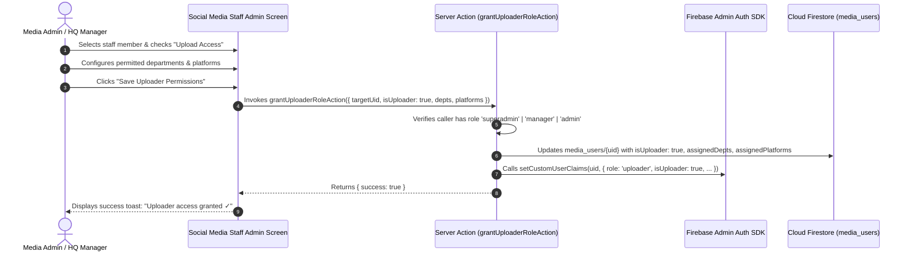
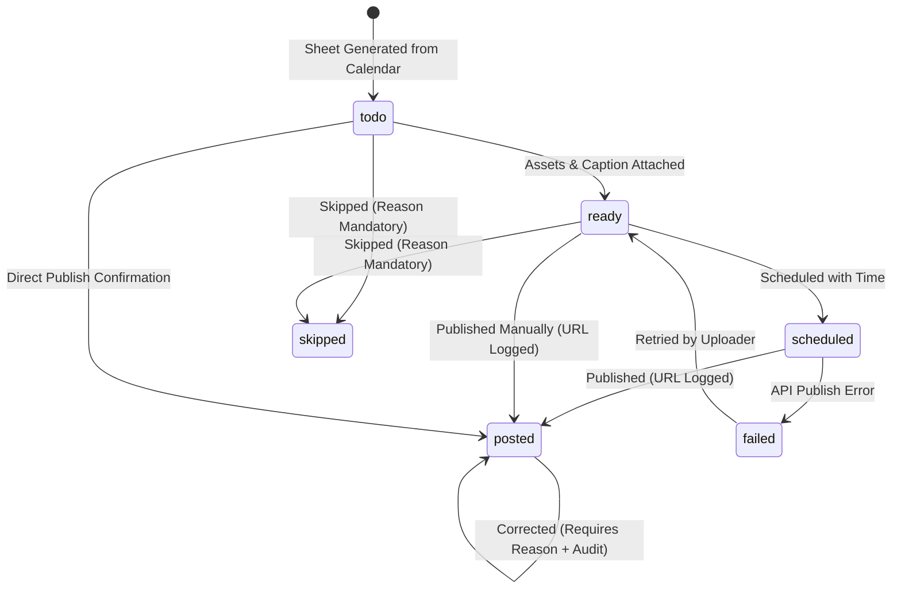

# Content Uploading System — Architectural Design & Specification
**Document Version:** 1.0.0  
**Target Platform:** KhanHub Monorepo (`apps/web`)  
**Stack:** Next.js 14 App Router, TypeScript, Tailwind CSS, Firebase (Auth + Cloud Firestore), Cloudinary, Vercel  
**Status:** PROPOSED FOR APPROVAL (Design Phase Only — No feature code written)  

---

## 1. Executive Summary & Core Tenets

The **Content Uploading System** is an independent operational pipeline designed to bridge content creation with external multi-channel publishing and public website media galleries.

### Key Architectural Tenets
1. **Decoupled Architecture (Read-Only Bridge to Creation):**  
   The existing monthly creation calendar (`media_calendar_tasks` and `media_content_categories`) is never written to or mutated. The uploading system references creation tasks strictly by ID.
2. **One Item, Multi-Platform Matrix (`upload_items`):**  
   Rather than creating 180 individual task documents per month (30 content items × 6 targets), the system stores **one document per content item per month**, encapsulating a map of platforms (`facebook`, `instagram`, `youtube`, `tiktok`, `whatsapp`, `website`). Updates use targeted field-path writes (`platforms.youtube.status = 'posted'`), preventing race conditions when different uploaders work simultaneously.
3. **Zero-Read Public Caching:**  
   Public visitors viewing department media galleries read **zero** Firestore documents during standard traffic. Public media is isolated into a denormalized collection (`public_media`) and served via Next.js 14 Server Components with Incremental Static Regeneration (ISR / `unstable_cache` + `revalidateTag`).
4. **Daily Rollup Aggregation (`upload_stats_daily`):**  
   Manager and CEO dashboards consume pre-aggregated daily rollup counters updated via atomic `FieldValue.increment` inside Server Actions. Loading a 30-day dashboard costs at most **31 document reads**, completely eliminating slow and costly collection scans.
5. **Strict Server-Action Write Security:**  
   Client-side writes are forbidden for all upload and public collections (`allow write: if false;`). All status changes, audit logs, and website publications execute exclusively through server actions using the Firebase Admin SDK, validating caller session claims.
6. **Multi-Campus by Design:**  
   Every item embeds `campusId` (default: `'vehari'`) and `departmentId` from inception, providing immediate support for future campuses (e.g. Burewala, Multan) without data schema migrations.

---

## 2. Phase 1 Inspection Findings

| # | Inspection Domain | Inspection Finding | Architectural Implication |
|---|---|---|---|
| **1** | **Creation Calendar** | Located at `apps/web/src/app/departments/social-media/dashboard/admin/calendar/page.tsx`. Uses collections `media_content_categories` (~10 default rows) and `media_calendar_tasks`. Task schema: `id`, `date`, `categoryId`, `categoryName`, `title`, `type`, `assignedRole`, `assignedStaffId`, `assignedStaffName`, `isCompleted`, `note`. | The Upload Sheet will read `media_calendar_tasks` for a selected month (`YYYY-MM`) as an idempotent seed source, generating matching `upload_items` records. |
| **2** | **Social Media Auth & Roles** | Users stored in `media_users`. `universalAuth.ts` maps `'social-media'` with custom domain `@media.khanhub.com.pk`, session key `media_session`, dashboard path `/departments/social-media/dashboard`. Existing roles: `'admin'`, `'manager'`, `'staff'`, `'superadmin'`. Claims managed via `setUserDashboardClaims`. | We introduce a dedicated sub-role/permission `'uploader'` assigned to `media_users` records and reflected in custom claims for instant route gating. |
| **3** | **Department Public Pages** | Standalone pages exist under `apps/web/src/app/departments/[dept]/page.tsx` (`hospital`, `rehab`, `spims`, `it`, `job-center`, `sukoon`, `welfare`, `social-media`). Currently client components with hero and tab bars. `apps/web/src/app/media/page.tsx` has static hardcoded arrays. | Add a clean "Media" pill/button to every department navigation header pointing to `/departments/[dept]/media`. Department media pages will be server-rendered with ISR. |
| **4** | **Cloudinary Pipeline** | `apps/web/src/lib/cloudinaryUpload.ts` converts images to WebP client-side at 0.85 quality (`convertImageToWebP`) before direct XHR POST to Cloudinary endpoint. Accepts custom target folder (defaults to `Khan Hub/rehab`). | Reuse `cloudinaryUpload.ts` with structured folder `Khan Hub/content-upload/[dept]/[YYYY-MM]`. Images are uploaded; videos are never uploaded to Cloudinary, only embedded via URLs. |
| **5** | **Hosting & Scheduling** | Hosted on Vercel (`apps/web/vercel.json`, Next.js 14 App Router). No Cloud Functions exist in `firebase.json`. | Automated scheduled tasks, overdue checks, and adapter publishers will utilize Vercel Cron Jobs (`vercel.json` `"crons"`) triggering secure Route Handlers (`/api/cron/...`) authenticated via `CRON_SECRET`. |
| **6** | **Existing Firestore Rules** | `firestore.rules` lines 1396-1401 match `{collectionId}/{docId}` with `^media_.*` and `^it_.*`, allowing client read/write for media admins. Line 1407 matches suffixes `_staff`, `_attendance`, `_duty_logs`, and `^[a-z0-9_-]+_audit$`. | **Critical Rule:** Collections must NOT start with `media_` or end with `_audit`. We use `upload_items`, `public_media`, `upload_stats_daily`, `upload_audit_logs`, and `upload_settings`. |

---

## 3. Section A: Data Model

### 3.1 Department & Campus Canonical Registry

To eliminate inconsistencies (`sukoon` vs `sukoon-center`, `job-center` vs `jobcenter`), all departments and campuses are resolved through a single TypeScript registry:

```typescript
// apps/web/src/lib/upload/departmentRegistry.ts

export type CanonicalCampusId = 'vehari' | 'burewala' | 'multan';

export type CanonicalDeptId =
  | 'rehab'
  | 'hospital'
  | 'spims'
  | 'it'
  | 'job-center'
  | 'sukoon'
  | 'welfare'
  | 'social-media'
  | 'hq';

export interface DepartmentMeta {
  id: CanonicalDeptId;
  name: string;
  slug: string;
  aliases: string[];
  publicPath: string;
  badgeColor: string;
}

export const CANONICAL_DEPARTMENTS: Record<CanonicalDeptId, DepartmentMeta> = {
  rehab: {
    id: 'rehab',
    name: 'KhanHub Rehabilitation Center',
    slug: 'rehab',
    aliases: ['rehabilitation', 'rehab-center', 'rehab_center'],
    publicPath: '/departments/rehab',
    badgeColor: 'bg-emerald-50 text-emerald-700 border-emerald-200'
  },
  hospital: {
    id: 'hospital',
    name: 'KhanHub Hospital & Medical Center',
    slug: 'hospital',
    aliases: ['medical-center', 'medical', 'hospital_center'],
    publicPath: '/departments/hospital',
    badgeColor: 'bg-blue-50 text-blue-700 border-blue-200'
  },
  spims: {
    id: 'spims',
    name: 'SPIMS College & Health Sciences',
    slug: 'spims',
    aliases: ['institute-health-sciences', 'spims-college', 'college'],
    publicPath: '/departments/spims',
    badgeColor: 'bg-teal-50 text-teal-700 border-teal-200'
  },
  it: {
    id: 'it',
    name: 'KhanHub IT & Software Solutions',
    slug: 'it',
    aliases: ['it-department', 'tech', 'software'],
    publicPath: '/departments/it',
    badgeColor: 'bg-indigo-50 text-indigo-700 border-indigo-200'
  },
  'job-center': {
    id: 'job-center',
    name: 'KhanHub Job Placement Center',
    slug: 'job-center',
    aliases: ['jobcenter', 'job_center', 'job-placement', 'jobs'],
    publicPath: '/departments/job-center',
    badgeColor: 'bg-amber-50 text-amber-700 border-amber-200'
  },
  sukoon: {
    id: 'sukoon',
    name: 'Sukoon Mental Wellness & Care',
    slug: 'sukoon',
    aliases: ['sukoon-center', 'sukoon_center', 'wellness'],
    publicPath: '/departments/sukoon',
    badgeColor: 'bg-purple-50 text-purple-700 border-purple-200'
  },
  welfare: {
    id: 'welfare',
    name: 'KhanHub Community Welfare Org',
    slug: 'welfare',
    aliases: ['social-welfare', 'social_welfare', 'welfare-org'],
    publicPath: '/departments/welfare',
    badgeColor: 'bg-rose-50 text-rose-700 border-rose-200'
  },
  'social-media': {
    id: 'social-media',
    name: 'KhanHub Social Media & Studio',
    slug: 'social-media',
    aliases: ['media', 'social_media', 'creative-studio'],
    publicPath: '/departments/social-media',
    badgeColor: 'bg-pink-50 text-pink-700 border-pink-200'
  },
  hq: {
    id: 'hq',
    name: 'KhanHub Headquarters',
    slug: 'hq',
    aliases: ['headquarters', 'central', 'admin'],
    publicPath: '/hq',
    badgeColor: 'bg-slate-50 text-slate-700 border-slate-200'
  }
};

export function resolveCanonicalDept(input?: string): CanonicalDeptId {
  if (!input) return 'social-media';
  const clean = input.trim().toLowerCase();
  for (const [key, meta] of Object.entries(CANONICAL_DEPARTMENTS)) {
    if (key === clean || meta.slug === clean || meta.aliases.includes(clean)) {
      return key as CanonicalDeptId;
    }
  }
  return 'social-media';
}
```

---

### 3.2 Collection Schemas & Field Specifications

#### Collection 1: `upload_items`
- **Purpose:** Primary tracking document for each planned media item for the month across all 6 targets.
- **Document ID Pattern:** `{YYYY-MM}_{creationTaskId}` (e.g. `2026-11_task_78abc123`)
- **Queried Fields:** `month` (==), `departmentId` (==), `date` (ASC), `campusId` (==), `platforms.{platform}.assignedTo` (==), `platforms.{platform}.status` (==)

```typescript
export type UploadPlatformKey = 'facebook' | 'instagram' | 'youtube' | 'tiktok' | 'whatsapp' | 'website';

export type UploadPlatformStatus = 'todo' | 'ready' | 'scheduled' | 'posted' | 'failed' | 'skipped';

export interface PlatformPublishState {
  status: UploadPlatformStatus;
  postUrl?: string;          // Verified live post URL or embed link
  scheduledFor?: string;     // ISO timestamp if scheduled
  postedAt?: string;         // ISO timestamp of publish confirmation
  postedBy?: string;         // Name / ID of staff user
  assignedTo?: string;       // Staff UID assigned to execute this target
  method: 'manual' | 'api';  // 'manual' (default) or 'api'
  skipReason?: string;       // Required if status === 'skipped'
  error?: string;            // Last error message if failed
  lastUpdated?: string;      // ISO timestamp
}

export interface UploadItemDoc {
  id: string;                               // '{YYYY-MM}_{creationTaskId}'
  month: string;                            // 'YYYY-MM'
  date: string;                             // 'YYYY-MM-DD' (Asia/Karachi)
  creationTaskId: string;                   // Reference ID to media_calendar_tasks
  creationCategoryId?: string;              // media_content_categories doc ID
  campusId: CanonicalCampusId;              // 'vehari' (default)
  departmentId: CanonicalDeptId;            // Resolved canonical department ID
  title: string;                            // Title from creation calendar or override
  caption: string;                          // Ready-to-copy social caption text
  hashtags: string[];                       // Tags (e.g. ['#KhanHub', '#Rehab'])
  contentType: 'image' | 'video';           // Distinguishes image vs video link
  assets: {
    primaryUrl: string;                     // Cloudinary image URL or video embed URL
    thumbnailUrl?: string;                  // Cover image URL
    cloudinaryPublicId?: string;            // Cloudinary asset ID if uploaded image
    sourceType: 'cloudinary_image' | 'youtube_link' | 'social_link';
    durationSeconds?: number;
  };
  platforms: Record<UploadPlatformKey, PlatformPublishState>;
  syncStatus: 'in_sync' | 'out_of_sync' | 'orphaned'; // Tracks creation calendar changes
  createdAt: string;                        // ISO string
  updatedAt: string;                        // ISO string
  createdYear: number;                      // 2026
  createdMonth: number;                     // 11
}
```

*JSON Document Example (`upload_items/2026-11_task_981`):*
```json
{
  "id": "2026-11_task_981",
  "month": "2026-11",
  "date": "2026-11-05",
  "creationTaskId": "task_981",
  "creationCategoryId": "cat_rehab_vid",
  "campusId": "vehari",
  "departmentId": "rehab",
  "title": "Patient Recovery Story — Episode 14",
  "caption": "A story of resilience and healing at KhanHub Rehabilitation Center. #Rehab #KhanHub",
  "hashtags": ["#Rehab", "#KhanHub", "#Recovery"],
  "contentType": "video",
  "assets": {
    "primaryUrl": "https://www.youtube.com/watch?v=dQw4w9WgXcQ",
    "thumbnailUrl": "https://res.cloudinary.com/dhshtdrjp/image/upload/v1/KhanHub/rehab/thumb_14.webp",
    "sourceType": "youtube_link",
    "durationSeconds": 185
  },
  "platforms": {
    "facebook": {
      "status": "posted",
      "postUrl": "https://facebook.com/khanhub/posts/1029384756",
      "postedAt": "2026-11-05T14:30:00Z",
      "postedBy": "Ahmed Ali",
      "assignedTo": "user_media_02",
      "method": "manual"
    },
    "instagram": {
      "status": "posted",
      "postUrl": "https://instagram.com/p/DB123xyz",
      "postedAt": "2026-11-05T14:32:00Z",
      "postedBy": "Ahmed Ali",
      "assignedTo": "user_media_02",
      "method": "manual"
    },
    "youtube": {
      "status": "posted",
      "postUrl": "https://youtube.com/watch?v=dQw4w9WgXcQ",
      "postedAt": "2026-11-05T14:25:00Z",
      "postedBy": "Ahmed Ali",
      "assignedTo": "user_media_02",
      "method": "manual"
    },
    "tiktok": {
      "status": "todo",
      "assignedTo": "user_media_03",
      "method": "manual"
    },
    "whatsapp": {
      "status": "posted",
      "postUrl": "https://chat.whatsapp.com/channel-post",
      "postedAt": "2026-11-05T15:00:00Z",
      "postedBy": "Ahmed Ali",
      "assignedTo": "user_media_02",
      "method": "manual"
    },
    "website": {
      "status": "posted",
      "postUrl": "/departments/rehab/media",
      "postedAt": "2026-11-05T14:26:00Z",
      "postedBy": "Ahmed Ali",
      "assignedTo": "user_media_02",
      "method": "manual"
    }
  },
  "syncStatus": "in_sync",
  "createdAt": "2026-11-01T08:00:00Z",
  "updatedAt": "2026-11-05T15:00:00Z",
  "createdYear": 2026,
  "createdMonth": 11
}
```

---

#### Collection 2: `public_media`
- **Purpose:** Public-facing, denormalized read model for the website's department media galleries. Contains only sanitised, publicly viewable fields.
- **Document ID Pattern:** `{uploadItemId}` (e.g. `2026-11_task_981`)
- **Queried Fields:** `campusId` (==), `departmentId` (==), `visible` (==), `publishedAt` (DESC)

```typescript
export interface PublicMediaDoc {
  id: string;                     // Matches upload_items doc ID
  uploadItemId: string;           // Direct reference
  campusId: CanonicalCampusId;    // 'vehari'
  departmentId: CanonicalDeptId;  // 'rehab'
  title: string;
  description: string;
  mediaType: 'image' | 'video';
  // Sanitised media source payload
  media: {
    sourceType: 'image' | 'youtube' | 'facebook' | 'instagram' | 'tiktok';
    imageUrl?: string;            // Cloudinary WebP URL
    youtubeVideoId?: string;      // Extracted 11-char ID
    externalPostUrl?: string;     // Canonical direct social link
    thumbnailUrl: string;         // Always present for instant card preview
    aspectRatio?: '16:9' | '9:16' | '1:1' | '4:5';
  };
  tags: string[];
  visible: boolean;               // True = displayed; False = hidden by admin
  publishedAt: string;            // ISO String
  publishedDate: string;          // 'YYYY-MM-DD'
  featured: boolean;              // Optional badge
  viewCount: number;              // Basic engagement counter
}
```

*JSON Document Example (`public_media/2026-11_task_981`):*
```json
{
  "id": "2026-11_task_981",
  "uploadItemId": "2026-11_task_981",
  "campusId": "vehari",
  "departmentId": "rehab",
  "title": "Patient Recovery Story — Episode 14",
  "description": "A story of resilience and healing at KhanHub Rehabilitation Center.",
  "mediaType": "video",
  "media": {
    "sourceType": "youtube",
    "youtubeVideoId": "dQw4w9WgXcQ",
    "externalPostUrl": "https://youtube.com/watch?v=dQw4w9WgXcQ",
    "thumbnailUrl": "https://res.cloudinary.com/dhshtdrjp/image/upload/v1/KhanHub/rehab/thumb_14.webp",
    "aspectRatio": "16:9"
  },
  "tags": ["rehab", "recovery", "inspiration"],
  "visible": true,
  "publishedAt": "2026-11-05T14:26:00Z",
  "publishedDate": "2026-11-05",
  "featured": false,
  "viewCount": 0
}
```

---

#### Collection 3: `upload_stats_daily`
- **Purpose:** Pre-aggregated daily posting metrics updated via atomic `FieldValue.increment` within Server Actions.
- **Document ID Pattern:** `{YYYY-MM-DD}` (e.g. `2026-11-05`)
- **Queried Fields:** `date` (DESC), `month` (==)

```typescript
export interface UploadDailyStatsDoc {
  id: string;                             // 'YYYY-MM-DD'
  date: string;                           // 'YYYY-MM-DD'
  month: string;                          // 'YYYY-MM'
  campusId: CanonicalCampusId;            // 'vehari'
  totalPlanned: number;                   // Incremented when items created
  totalPosted: number;                    // Incremented when any platform marked posted
  totalSkipped: number;                   // Incremented when platform skipped
  totalFailed: number;
  byPlatform: Record<UploadPlatformKey, {
    planned: number;
    posted: number;
    skipped: number;
    failed: number;
  }>;
  byDepartment: Record<CanonicalDeptId, {
    planned: number;
    posted: number;
  }>;
  updatedAt: string;
}
```

*JSON Document Example (`upload_stats_daily/2026-11-05`):*
```json
{
  "id": "2026-11-05",
  "date": "2026-11-05",
  "month": "2026-11",
  "campusId": "vehari",
  "totalPlanned": 6,
  "totalPosted": 5,
  "totalSkipped": 0,
  "totalFailed": 0,
  "byPlatform": {
    "facebook": { "planned": 1, "posted": 1, "skipped": 0, "failed": 0 },
    "instagram": { "planned": 1, "posted": 1, "skipped": 0, "failed": 0 },
    "youtube": { "planned": 1, "posted": 1, "skipped": 0, "failed": 0 },
    "tiktok": { "planned": 1, "posted": 0, "skipped": 0, "failed": 0 },
    "whatsapp": { "planned": 1, "posted": 1, "skipped": 0, "failed": 0 },
    "website": { "planned": 1, "posted": 1, "skipped": 0, "failed": 0 }
  },
  "byDepartment": {
    "rehab": { "planned": 6, "posted": 5 },
    "hospital": { "planned": 0, "posted": 0 },
    "spims": { "planned": 0, "posted": 0 },
    "it": { "planned": 0, "posted": 0 },
    "job-center": { "planned": 0, "posted": 0 },
    "sukoon": { "planned": 0, "posted": 0 },
    "welfare": { "planned": 0, "posted": 0 },
    "social-media": { "planned": 0, "posted": 0 },
    "hq": { "planned": 0, "posted": 0 }
  },
  "updatedAt": "2026-11-05T15:00:00Z"
}
```

---

#### Collection 4: `upload_audit_logs`
- **Purpose:** Append-only audit log tracking task generation, status transitions, correction notes, and overrides.
- **Document ID Pattern:** Auto-generated Firestore ID
- **Queried Fields:** `uploadItemId` (==), `createdAt` (DESC), `performedBy` (==)

```typescript
export interface UploadAuditLogDoc {
  id: string;
  uploadItemId: string;
  platform?: UploadPlatformKey;
  action: 'sheet_generated' | 'status_changed' | 'post_url_updated' | 'post_corrected' | 'website_published' | 'website_hidden' | 'assignee_changed';
  previousStatus?: UploadPlatformStatus;
  newStatus?: UploadPlatformStatus;
  previousUrl?: string;
  newUrl?: string;
  reason?: string;                       // Mandatory when editing an already posted item
  performedBy: string;                   // User UID
  performedByName: string;               // User Display Name
  performedByRole: string;               // e.g. 'uploader' | 'media_admin' | 'superadmin'
  ipAddress?: string;
  createdAt: string;                     // ISO Timestamp
}
```

---

#### Collection 5: `upload_settings`
- **Purpose:** System configuration containing social account URLs, active uploader rosters, and automation parameters.
- **Document ID Pattern:** Fixed singletons (`config_vehari`, `account_labels`)

```typescript
export interface UploadSettingsDoc {
  id: 'config_vehari';
  campusId: CanonicalCampusId;
  platformAccounts: Record<UploadPlatformKey, {
    accountHandle: string;
    profileUrl: string;
    isActive: boolean;
  }>;
  autoSyncWithCreation: boolean;
  allowedVideoDomains: string[];
  maxPostRetentionDays: number;
  updatedAt: string;
  updatedBy: string;
}
```

---

## 4. Section B: Roles & Permissions

### 4.1 Permission Matrix

| Action | Public Visitor | Department Admin | Uploader | Media Admin | HQ Manager | Superadmin |
|---|:---:|:---:|:---:|:---:|:---:|:---:|
| View Public Media Galleries | **Allowed** | **Allowed** | **Allowed** | **Allowed** | **Allowed** | **Allowed** |
| View Personal "My Queue" | Denied | Denied | **Own Tasks** | **All Tasks** | **All Tasks** | **All Tasks** |
| View Full Upload Sheet | Denied | Read-Only (Own Dept) | Assigned Rows | **Full Access** | **Full Access** | **Full Access** |
| Generate Upload Sheet from Calendar | Denied | Denied | Denied | **Allowed** | **Allowed** | **Allowed** |
| Sync Creation Calendar Changes | Denied | Denied | Denied | **Allowed** | **Allowed** | **Allowed** |
| Assign Task to Uploader | Denied | Denied | Denied | **Allowed** | **Allowed** | **Allowed** |
| Mark Item as Posted (Manual) | Denied | Denied | **Assigned Only** | **Allowed** | **Allowed** | **Allowed** |
| Skip Item (With Mandatory Reason) | Denied | Denied | **Assigned Only** | **Allowed** | **Allowed** | **Allowed** |
| Edit After Posted (Change URL/Caption) | Denied | Denied | Denied (Locked) | **Requires Reason** | **Requires Reason** | **Requires Reason** |
| Publish to Website (`public_media`) | Denied | Denied | **Allowed** | **Allowed** | **Allowed** | **Allowed** |
| Hide / Unpublish Website Item | Denied | Denied | Denied | **Allowed** | **Allowed** | **Allowed** |
| View Posting Progress Dashboard | Denied | Read-Only (Own Dept) | Personal Stats | **Full Dept** | **Full Campus** | **Full System** |
| Modify Account Labels & Settings | Denied | Denied | Denied | **Allowed** | **Allowed** | **Allowed** |

### 4.2 Uploader Role Storage & Grant Flow



1. **Storage in Firestore (`media_users`):**  
   The user document in `media_users` stores:
   ```typescript
   {
     isUploader: boolean;
     uploaderProfile?: {
       assignedDepartments: CanonicalDeptId[];
       assignedPlatforms: UploadPlatformKey[];
       dailyTaskQuota?: number;
       status: 'active' | 'suspended';
     }
   }
   ```
2. **Custom Claims Token Sync:**  
   Calling `setUserDashboardClaims(uid, '/departments/social-media/dashboard/uploader', { isUploader: true })` injects `isUploader: true` into the JWT, enabling zero-database route protection inside Next.js Middleware and layout guards.

---

## 5. Section C: Security Rules & Catch-All Analysis

### 5.1 Analysis of Catch-All Rules in `firestore.rules`

In Cloud Firestore Security Rules, multiple `match` statements can match the same document path. **Crucially, rules are combined with logical OR: if ANY matching block returns `true`, the operation is granted.**

#### The Catch-All Traps Identified in Phase 1:
1. **The Prefix Trap (`firestore.rules` line 1396):**
   ```rules
   match /{collectionId}/{docId} {
     allow read: if (collectionId.matches('^media_.*') ... );
     allow write: if (collectionId.matches('^media_.*') && (isMediaAdminOrManager() ... ));
   }
   ```
   *Impact:* If we named the upload collection `media_upload_items` or `media_uploads`, this rule would trigger and **permit client-side writes**, completely bypassing our server-action requirement.
2. **The Suffix Trap (`firestore.rules` line 1407 & 1420):**
   ```rules
   match /{collectionId}/{docId} {
     allow create, update: if ( ... || collectionId.matches('^[a-z0-9_-]+_audit$') ... );
   }
   ```
   *Impact:* If we named the audit log `upload_audit`, the regex `^[a-z0-9_-]+_audit$` matches (`upload_audit`). This would grant client-side update access to any user satisfying `isHqSuperOrManager()`.

#### The Architectural Solution:
- We name the collections strictly:
  - `upload_items` (Prefix `upload_`, suffix `_items` — 0 regex matches)
  - `public_media` (Prefix `public_`, suffix `_media` — 0 regex matches)
  - `upload_stats_daily` (Prefix `upload_`, suffix `_daily` — 0 regex matches)
  - `upload_audit_logs` (Prefix `upload_`, suffix `_logs` — avoids `_audit` match)
  - `upload_settings` (Prefix `upload_`, suffix `_settings` — 0 regex matches)

### 5.2 Proposed Rules Specification (`firestore.rules.proposed`)

```rules
rules_version = '2';
service cloud.firestore {
  match /databases/{database}/documents {

    // ── Helper functions for Upload System ──────────────────────────────
    function isAuth() {
      return request.auth != null;
    }

    function isHqAdmin() {
      return isAuth() && (
        request.auth.token.role == 'superadmin' ||
        request.auth.token.role == 'manager'
      );
    }

    function isMediaAdmin() {
      return isAuth() && (
        request.auth.token.role == 'admin' ||
        request.auth.token.role == 'manager' ||
        request.auth.token.role == 'superadmin'
      );
    }

    // 1. PUBLIC MEDIA: Public read for published, visible website items.
    // Writes strictly blocked from clients (Admin SDK Server Actions only).
    match /public_media/{docId} {
      allow read: if resource.data.visible == true || isMediaAdmin();
      allow write: if false; // All writes execute via Server Actions
    }

    // 2. UPLOAD ITEMS: Internal planning data is NEVER public.
    // Authenticated media staff can read; writes strictly through Server Actions.
    match /upload_items/{docId} {
      allow read: if isAuth();
      allow write: if false; // Status updates & marking posted require Server Action verification
    }

    // 3. DAILY ROLLUP STATS: Read-only for authenticated managers & dashboards.
    match /upload_stats_daily/{dateDoc} {
      allow read: if isAuth();
      allow write: if false; // Atomic increment by Server Actions only
    }

    // 4. AUDIT LOGS: Immutable history.
    match /upload_audit_logs/{auditId} {
      allow read: if isMediaAdmin() || isHqAdmin();
      allow write: if false; // Server Actions append only
    }

    // 5. UPLOAD SETTINGS: Global accounts & platform configuration.
    match /upload_settings/{settingDoc} {
      allow read: if isAuth();
      allow write: if false; // Server Actions only
    }
  }
}
```

### 5.3 Emulator Test Case Matrix

| Case ID | Target Collection | Auth Role / Actor | Operation | Payload / Condition | Expected Result |
|---|---|---|---|---|:---:|
| **TC-01** | `/public_media/doc1` | Unauthenticated (Public) | Read (`get`/`list`) | `resource.data.visible == true` | **ALLOW** |
| **TC-02** | `/public_media/doc2` | Unauthenticated (Public) | Read (`get`) | `resource.data.visible == false` | **DENY** |
| **TC-03** | `/public_media/doc1` | Media Admin (Client SDK) | Create / Update | Direct client write | **DENY** |
| **TC-04** | `/upload_items/item1` | Unauthenticated (Public) | Read (`get`) | Any | **DENY** |
| **TC-05** | `/upload_items/item1` | Uploader (Client SDK) | Read (`get`) | Authenticated | **ALLOW** |
| **TC-06** | `/upload_items/item1` | Uploader (Client SDK) | Update (`updateDoc`) | Attempting client write | **DENY** |
| **TC-07** | `/upload_audit_logs/a1` | Department Admin | Read | Non-media admin | **DENY** |
| **TC-08** | `/upload_audit_logs/a1` | Media Admin | Read | Media Admin role | **ALLOW** |
| **TC-09** | `/upload_audit_logs/a1` | Superadmin (Client SDK) | Delete / Update | Any client write | **DENY** |
| **TC-10** | `/upload_stats_daily/d1`| Uploader / Manager | Read | Authenticated | **ALLOW** |

---

## 6. Section D: Composite Indexes Specification

### 6.1 Index Specifications (`firestore.indexes.proposed.json`)

```json
{
  "indexes": [
    {
      "collectionGroup": "public_media",
      "queryScope": "COLLECTION",
      "fields": [
        { "fieldPath": "campusId", "order": "ASCENDING" },
        { "fieldPath": "departmentId", "order": "ASCENDING" },
        { "fieldPath": "visible", "order": "ASCENDING" },
        { "fieldPath": "publishedAt", "order": "DESCENDING" }
      ]
    },
    {
      "collectionGroup": "public_media",
      "queryScope": "COLLECTION",
      "fields": [
        { "fieldPath": "campusId", "order": "ASCENDING" },
        { "fieldPath": "visible", "order": "ASCENDING" },
        { "fieldPath": "publishedAt", "order": "DESCENDING" }
      ]
    },
    {
      "collectionGroup": "upload_items",
      "queryScope": "COLLECTION",
      "fields": [
        { "fieldPath": "campusId", "order": "ASCENDING" },
        { "fieldPath": "month", "order": "ASCENDING" },
        { "fieldPath": "date", "order": "ASCENDING" }
      ]
    },
    {
      "collectionGroup": "upload_items",
      "queryScope": "COLLECTION",
      "fields": [
        { "fieldPath": "campusId", "order": "ASCENDING" },
        { "fieldPath": "month", "order": "ASCENDING" },
        { "fieldPath": "departmentId", "order": "ASCENDING" },
        { "fieldPath": "date", "order": "ASCENDING" }
      ]
    },
    {
      "collectionGroup": "upload_audit_logs",
      "queryScope": "COLLECTION",
      "fields": [
        { "fieldPath": "uploadItemId", "order": "ASCENDING" },
        { "fieldPath": "createdAt", "order": "DESCENDING" }
      ]
    }
  ],
  "fieldOverrides": []
}
```

### 6.2 Index Justifications
1. **`public_media` (campusId + departmentId + visible + publishedAt):**  
   Powers the department public media gallery: `where('campusId', '==', 'vehari').where('departmentId', '==', 'rehab').where('visible', '==', true).orderBy('publishedAt', 'desc')`. Guarantees instantaneous, index-backed gallery queries.
2. **`public_media` (campusId + visible + publishedAt):**  
   Powers the global website media page with all departments combined.
3. **`upload_items` (campusId + month + date):**  
   Powers the monthly upload matrix sheet, fetching all 30 planned content items in chronological order with zero client sorting.
4. **`upload_items` (campusId + month + departmentId + date):**  
   Supports department-filtered views on the upload matrix sheet.
5. **`upload_audit_logs` (uploadItemId + createdAt):**  
   Powers the change history drawer on a task item, sorting audit entries newest first.

---

## 7. Section E: Routes & Screen Wireframes

### Screen 1: Upload Matrix Sheet (Manager / Media Admin)
**Route:** `/departments/social-media/dashboard/admin/upload-sheet`

```
┌────────────────────────────────────────────────────────────────────────────────────────────────────────┐
│  KhanHub Upload Sheet  │  Month: [ < November 2026 > ]  │  Campus: [ Vehari ▼ ]  │  [Sync Calendar]  │
├────────────────────────────────────────────────────────────────────────────────────────────────────────┤
│  PROGRESS: [████████████████████░░░░░░░░░░░░░] 132/180 Posted (73%)  │ Filter: [Dept: All ▼] [Status ▼] │
├────────────┬─────────────────────────┬──────────┬───────────┬─────────┬─────────┬──────────┬───────────┤
│ Date       │ Content Item Title      │ Facebook │ Instagram │ YouTube │ TikTok  │ WhatsApp │ Website   │
├────────────┼─────────────────────────┼──────────┼───────────┼─────────┼─────────┼──────────┼───────────┤
│ 2026-11-01 │ Rehab Patient Interview │ [✓ Done] │ [✓ Done]  │ [✓ Done]│ [✓ Done]│ [✓ Done] │ [✓ Live]  │
│ 2026-11-02 │ SPIMS Lab Tech Intro    │ [✓ Done] │ [✓ Done]  │ [- N/A] │ [✓ Done]│ [✓ Done] │ [✓ Live]  │
│ 2026-11-03 │ Hospital Eye Camp Reel  │ [✓ Done] │ [✓ Done]  │ [✓ Done]│ [⚠ Over]│ [✓ Done] │ [✓ Live]  │
│ 2026-11-04 │ Job Placement Story     │ [✓ Done] │ [✓ Done]  │ [✓ Done]│ [✓ Done]│ [✓ Done] │ [✓ Live]  │
│ 2026-11-05 │ Recovery Milestone #14  │ [✓ Done] │ [✓ Done]  │ [✓ Done]│ [⏳ Todo]│ [✓ Done] │ [✓ Live]  │
│   ...      │          ...            │   ...    │    ...    │   ...   │   ...   │   ...    │    ...    │
│ 2026-11-30 │ Month-End Highlights    │ [⏳ Todo]│ [⏳ Todo] │ [⏳ Todo]│ [⏳ Todo]│ [⏳ Todo] │ [⏳ Todo] │
└────────────┴─────────────────────────┴──────────┴───────────┴─────────┴─────────┴──────────┴───────────┘
 [Legend: [✓ Done] = Posted  [⏳ Todo] = Pending  [⚠ Over] = Overdue  [⊘ Skip] = Skipped  [- N/A] = Not Req]
```

#### Task Detail Drawer (Slide-out on Cell Click):
```
┌─────────────────────────────────────────────────────────────┐
│  TASK DETAILS — Recovery Milestone #14 (TikTok)            [✕]│
├─────────────────────────────────────────────────────────────┤
│  Date: 2026-11-05  │ Department: Rehab  │ Type: Video       │
│  Creation Reference: #task_981 (Synced ✓)                   │
├─────────────────────────────────────────────────────────────┤
│  CAPTION & HASHTAGS:                                        │
│  [ Copy Caption ]                                           │
│  "A story of resilience and healing at KhanHub Rehab...    │
│   #Rehab #KhanHub #Recovery"                                │
├─────────────────────────────────────────────────────────────┤
│  ASSETS:                                                    │
│  • Video Source: https://youtu.be/dQw4w9WgXcQ [Open Video ↗]│
│  • Thumbnail: [ View / Download WebP Image ↗ ]              │
├─────────────────────────────────────────────────────────────┤
│  PUBLISH ACTION:                                            │
│  Status: [ Todo ▼ ]                                         │
│  Target Post URL: [ https://www.tiktok.com/@khanhub/video/... ]
│  Assigned To: [ Ahmed Ali (Uploader) ▼ ]                    │
│                                                             │
│  [ Mark as Posted on TikTok ✓ ]   [ Skip Platform... ]      │
├─────────────────────────────────────────────────────────────┤
│  AUDIT TRAIL:                                               │
│  • 2026-11-01 08:00 — Generated from Creation Calendar      │
│  • 2026-11-04 12:15 — Assigned to Ahmed Ali by MediaAdmin   │
└─────────────────────────────────────────────────────────────┘
```

---

### Screen 2: Uploader "My Queue" Screen
**Route:** `/departments/social-media/dashboard/uploader`

```
┌────────────────────────────────────────────────────────────────────────────────────────────────────────┐
│  My Upload Queue — Ahmed Ali (Uploader)                │ Today: Thursday, 5 Nov 2026 (PKT)             │
├────────────────────────────────────────────────────────────────────────────────────────────────────────┤
│  🔴 OVERDUE (1 Task)                                                                                   │
│  ┌──────────────────────────────────────────────────────────────────────────────────────────────────┐  │
│  │ 2026-11-03 • Hospital Eye Camp Reel • TikTok                                   [ 2 Days Late ⚠ ] │  │
│  │ Asset: https://youtu.be/xyz123  │  Caption: "Free eye checkup camp results..."                   │  │
│  │ Post URL: [ Paste TikTok URL here ]  [ Mark Posted ✓ ]  [ Skip with Reason ]                     │  │
│  └──────────────────────────────────────────────────────────────────────────────────────────────────┘  │
│                                                                                                        │
│  🟢 TODAY'S QUEUE (1 Item • 3 Platforms Remaining)                                                     │
│  ┌──────────────────────────────────────────────────────────────────────────────────────────────────┐  │
│  │ 2026-11-05 • Recovery Milestone #14 • KhanHub Rehab Center                                       │  │
│  │ Platforms: [FB ✓] [IG ✓] [YT ✓] [TikTok ⏳] [WA ✓] [Web ✓]                                       │  │
│  │ Quick Action: [ Mark All Remaining Platforms Posted (Single URL or Batch) ]                      │  │
│  └──────────────────────────────────────────────────────────────────────────────────────────────────┘  │
│                                                                                                        │
│  ⚪ UPCOMING (Tomorrow & Next 5 Days) — 12 Items                                                        │
└────────────────────────────────────────────────────────────────────────────────────────────────────────┘
```

---

### Screen 3: Quick Direct Upload Form
**Route:** `/departments/social-media/dashboard/admin/upload-new`

```
┌────────────────────────────────────────────────────────────────────────┐
│  Create Direct Content & Upload Item                                  │
├────────────────────────────────────────────────────────────────────────┤
│  Content Title:      [ e.g. Free Medical Camp Highlights             ] │
│  Department:         [ KhanHub Hospital ▼ ]   Campus: [ Vehari ▼ ]    │
│  Publish Date:       [ 2026-11-06 ] (YYYY-MM-DD)                      │
│  Content Type:       ( ) Image Photo Post   (•) Video Link            │
│                                                                        │
│  [ If Video Link Selected ]:                                          │
│  Video Embed URL:    [ https://www.youtube.com/watch?v=...          ] │
│  Cover Image:        [ Drag & Drop WebP / JPG Image ] (Cloudinary)    │
│                                                                        │
│  Caption & Tags:                                                      │
│  [ Enter text with hashtags...                                      ] │
│                                                                        │
│  Publish Targets:                                                     │
│  [✓] Facebook   [✓] Instagram   [✓] YouTube   [✓] TikTok   [✓] WhatsApp│
│  [✓] Publish to Department Website Gallery Immediately                │
│                                                                        │
│  [ Create Content & Enqueue for Publishing ]                          │
└────────────────────────────────────────────────────────────────────────┘
```

---

### Screen 4: Executive CEO & Manager Dashboard
**Route:** `/departments/social-media/dashboard/admin/upload-analytics` (and embedded in HQ Superadmin)

```
┌────────────────────────────────────────────────────────────────────────────────────────────────────────┐
│  KhanHub Operational Media & Upload Command Center                  │  Month: [ November 2026 ▼ ]      │
├────────────────────────────────────────────────────────────────────────────────────────────────────────┤
│  OVERALL COMPLETION    │  TODAY'S POSTS          │  OVERDUE ITEMS       │  ACTIVE UPLOADERS            │
│  132 / 180 (73.3%)     │  5 / 6 Completed        │  2 Tasks Flagged     │  4 Assigned                  │
├────────────────────────────────────────────────────────────────────────────────────────────────────────┤
│  PERFORMANCE BY PLATFORM:                                                                              │
│  • Facebook:   [████████████████████░░] 26/30 (86%)  • TikTok:     [████████████░░░░░░░░] 16/30 (53%)  │
│  • Instagram:  [███████████████████░░░] 25/30 (83%)  • WhatsApp:   [████████████████████] 28/30 (93%)  │
│  • YouTube:    [████████████████░░░░░░] 21/30 (70%)  • Website:    [████████████████░░░░] 20/30 (66%)  │
├────────────────────────────────────────────────────────────────────────────────────────────────────────┤
│  PERFORMANCE BY DEPARTMENT:                                                                            │
│  • Rehab:      [████████████████████] 28/30 (93%)    • Job Center: [████████████████░░░░] 21/30 (70%)  │
│  • Hospital:   [██████████████████░░] 24/30 (80%)    • Welfare:    [██████████████░░░░░░] 19/30 (63%)  │
│  • SPIMS:      [███████████████░░░░░] 20/30 (66%)    • Sukoon:     [██████████████████░░] 20/30 (66%)  │
└────────────────────────────────────────────────────────────────────────────────────────────────────────┘
```

---

### Screen 5: Department Public Media Page
**Route:** `/departments/[dept]/media` (e.g. `/departments/rehab/media`)

```
┌────────────────────────────────────────────────────────────────────────────────────────────────────────┐
│  [ KhanHub Logo ]    Rehab Center  •  Hospital  •  SPIMS  •  Jobs  •  Welfare       [ Call / Helpline ] │
├────────────────────────────────────────────────────────────────────────────────────────────────────────┤
│  HERO SECTION:                                                                                         │
│  KhanHub Rehabilitation Center — Official Media & Gallery                                              │
│  Explore real patient recovery stories, therapy sessions, and campus life.                             │
│                                                                                                        │
│  FILTERS: [ All Media ]  [ Videos (YouTube/Reels) ]  [ Photos & Graphics ]  │ Search: [ ________ 🔍 ] │
├────────────────────────────────────────────────────────────────────────────────────────────────────────┤
│  MEDIA GRID (24 items per page, Responsive 1 -> 2 -> 3 columns):                                       │
│                                                                                                        │
│  ┌─────────────────────────┐  ┌─────────────────────────┐  ┌─────────────────────────┐               │
│  │ [ YouTube Thumbnail ]   │  │ [ High-Res WebP Photo ] │  │ [ TikTok Video Card ]   │               │
│  │ ▶ 3:15                  │  │ 📷 Photo Gallery        │  │ 📱 Short Reel           │               │
│  │ Patient Recovery Ep. 14 │  │ Morning Yoga Session    │  │ Quick Counselor Tip     │               │
│  │ Published: 5 Nov 2026   │  │ Published: 4 Nov 2026   │  │ Published: 3 Nov 2026   │               │
│  └─────────────────────────┘  └─────────────────────────┘  └─────────────────────────┘               │
│  ┌─────────────────────────┐  ┌─────────────────────────┐  ┌─────────────────────────┐               │
│  │ [ YouTube Thumbnail ]   │  │ [ YouTube Thumbnail ]   │  │ [ High-Res WebP Photo ] │               │
│  │ Physical Therapy Round  │  │ Family Day Highlights   │  │ Vocational Workshop     │               │
│  └─────────────────────────┘  └─────────────────────────┘  └─────────────────────────┘               │
│                                                                                                        │
│                          [ < Previous Page ]    Page 1 of 4    [ Next Page > ]                         │
└────────────────────────────────────────────────────────────────────────────────────────────────────────┘
```

---

## 8. Section F: Workflow, State Machine & Correction Policy

### 8.1 Platform Task State Machine



### 8.2 State Transition Authorization Matrix
- `todo` -> `ready` / `scheduled` / `posted`: Uploader assigned, Media Admin, HQ Manager, Superadmin.
- `posted` -> `posted` (Correction): Media Admin, HQ Manager, Superadmin only. Blocked for standard uploaders to maintain audit integrity.
- `todo` / `ready` -> `skipped`: Requires non-empty `skipReason` string (e.g. *"Department had no physical event today; video canceled"*).

### 8.3 Creation Calendar Sync Dynamics
- When content creators update a task in `media_calendar_tasks` (e.g. change title, reassign staff):
  - Clicking **"Sync Changes"** in the Upload Sheet checks existing `upload_items` where `creationTaskId == task.id`.
  - It safely patches `title`, `creationCategoryId`, and `syncStatus = 'in_sync'`.
  - **Zero Overwrite Guarantee:** If a platform status is already `'posted'` or `'skipped'`, sync **never** resets it to `'todo'`.

---

## 9. Section G: Website Publishing Pipeline

### 9.1 Image Pipeline
1. **Client-side Compression:** When an image is selected, `convertImageToWebP(file)` converts it to WebP format with 0.85 quality in canvas.
2. **Cloudinary Upload:** Uploads directly to Cloudinary folder: `Khan Hub/content-upload/${departmentId}/${YYYY-MM}/`.
3. **Optimized Delivery:** Image URLs stored in `public_media` leverage Cloudinary automatic responsive transformations: `f_auto,q_auto,w_800`.

### 9.2 Safe Video Embed & Preview Architecture
**Videos are NEVER hosted on our servers or Cloudinary (eliminates bandwidth & storage costs).**
- **YouTube:**
  - Extracted to video ID (matches `^[a-zA-Z0-9_-]{11}$`).
  - Rendered using the **Facade Pattern**: displays the high-res YouTube thumbnail (`https://img.youtube.com/vi/${id}/hqdefault.jpg`) with a play overlay.
  - The `<iframe>` using privacy-enhanced domain `https://www.youtube-nocookie.com/embed/${id}?autoplay=1` is **only rendered on click**.
- **Instagram / Facebook / TikTok:**
  - Hosted videos are rendered as rich preview cards with platform brand badge, cover thumbnail, caption snippet, and a safe external button: *"Watch on Instagram ↗"*.
  - Prevents third-party tracking scripts, cookie compliance bloat, and broken mobile embeds.

### 9.3 Allowlisted Domains & Sanitization
All post URLs and video links are validated against an explicit whitelist:
```typescript
export const ALLOWED_MEDIA_DOMAINS = [
  'youtube.com',
  'www.youtube.com',
  'youtu.be',
  'instagram.com',
  'www.instagram.com',
  'facebook.com',
  'www.facebook.com',
  'fb.watch',
  'tiktok.com',
  'www.tiktok.com',
  'chat.whatsapp.com',
  'whatsapp.com'
];
```

### 9.4 Next.js 14 ISR Caching & Revalidation
- Public department media pages use `unstable_cache`:
  ```typescript
  export const getDepartmentMedia = unstable_cache(
    async (dept: string, campus: string, page: number) => {
      // Fetch 24 docs from public_media
    },
    ['department-media-cache'],
    { revalidate: 3600, tags: [`media-${dept}`, `media-all`] }
  );
  ```
- When a server action marks an item `posted` on `website`, it calls:
  ```typescript
  revalidateTag(`media-${departmentId}`);
  revalidateTag('media-all');
  ```
  This guarantees immediate public updates while normal visitor traffic incurs **0 Firestore reads**.

---

## 10. Section H: Read Budget & Reporting Efficiency

### 10.1 Reads Per Screen Budget Table

| Screen / Operation | Query Pattern | Read Cost per Load | Cache / Optimization Mechanism |
|---|---|:---:|---|
| **Public Dept Media Page** | `public_media` where `dept == X & visible == true` limit 24 | **0 reads** (Cache Hit)<br>24 reads (On Revalidate) | Next.js 14 ISR (`unstable_cache` + `revalidateTag`) |
| **Upload Matrix Sheet** | `upload_items` where `month == YYYY-MM` | **~30 reads** (1 per content item) | Single query for the whole month; client-side matrix rendering |
| **Uploader "My Queue"** | `upload_items` where `assignedTo == uid` | **~10–25 reads** | Filtered by assigned uploader UID |
| **Task Drawer Audit Trail** | `upload_audit_logs` where `uploadItemId == ID` | **~2–5 reads** | Fetched on-demand only when drawer is opened |
| **CEO / Manager Dashboard** | `upload_stats_daily` where `month == YYYY-MM` | **~30 reads** (1 per day of month) | Pre-aggregated daily rollup docs. No item scans! |
| **Quick Upload Form** | Metadata / Settings singleton | **1 read** | Reads `upload_settings/config_vehari` |

### 10.2 Total Monthly System Read Budget
For 30 items/month across 9 departments (180 target publications):
- Manager checking upload sheet 10 times/day: $10 \times 30 = 300\text{ reads/day}$
- Uploaders completing tasks: $\approx 250\text{ reads/day}$
- CEO checking dashboard 5 times/day: $5 \times 30 = 150\text{ reads/day}$
- 10,000 public website visitors/day: **0 reads** (served from Vercel Edge Cache)
- **Total Estimated Firestore Reads:** $\approx 700\text{ reads/day}$ (well within Firebase free tier of 50,000 reads/day).

---

## 11. Section I: Platform Adapters & API Feasibility

### 11.1 Adapter TypeScript Interface

```typescript
// apps/web/src/lib/upload/adapters/types.ts

export interface PublishPayload {
  uploadItemId: string;
  departmentId: CanonicalDeptId;
  title: string;
  caption: string;
  hashtags: string[];
  mediaUrl: string;
  thumbnailUrl?: string;
  contentType: 'image' | 'video';
  scheduledTime?: string;
}

export interface PublishResult {
  success: boolean;
  externalPostUrl?: string;
  externalPostId?: string;
  publishedAt?: string;
  error?: string;
}

export interface PlatformPublishAdapter {
  platformKey: UploadPlatformKey;
  isApiSupported: boolean;
  publish(payload: PublishPayload): Promise<PublishResult>;
  verifyPostUrl(url: string): boolean;
}
```

### 11.2 Feasibility Analysis of Official APIs (Current 2024–2026 Audit Requirements)

| Platform | Official API Status | App Review & Audit Requirement | Feasibility Rating | Recommendation |
|---|---|---|:---:|---|
| **Facebook Pages** | Meta Graph API v20+ (`pages_manage_posts`, `pages_read_engagement`) | Requires Meta App Review & Business Verification. Tokens valid for 60 days (Page tokens perpetual if long-lived). | **Feasible (Phase 2)** | Start with Manual tracking; add Page Access Token integration in Phase 2. |
| **Instagram Business** | Instagram Graph API (`instagram_content_publish`) | Requires professional Instagram account linked to a verified Facebook Page + App Review. Strict media format checks. | **Feasible (Phase 2)** | Bundle with Facebook Pages integration in Phase 2. |
| **YouTube** | YouTube Data API v3 (`youtube.upload`) | **Strict Audit Rule:** New API projects are restricted to uploading **PRIVATE videos only** until passing an intensive Google Cloud Trust & Safety Audit and quota extension. Default quota (10,000 units/day) allows only ~6 video uploads per day (1,600 units/video). | **Low Feasibility for Automation** | **Manual Paste URL (Permanently Recommended).** Uploading directly via YouTube Studio ensures 4K processing, monetization settings, and thumbnail control. |
| **TikTok** | TikTok Content Posting API | Requires TikTok for Developers commercial app audit and user authorization with `video.upload` scope. Strict video encoding requirements. | **Moderate Feasibility (Phase 3)** | Keep manual for launch. |
| **WhatsApp** | WhatsApp Channels / Groups | **No public consumer API.** WhatsApp Business Cloud API supports only templated business-to-consumer messaging, not posting to open community groups or broadcast channels. | **Not Feasible via API** | **Keep Permanently Manual.** Uploader clicks "Copy Caption & Asset" and posts to WhatsApp in 5 seconds. |

### 11.3 Credential Storage & Security
- When Phase 2 Meta API integration occurs, OAuth tokens will be stored in server-only environment variables or encrypted in a private collection accessible exclusively by Admin SDK server actions. **Zero credentials will ever be exposed to client bundles.**

---

## 12. Section J: Multi-Campus Readiness

1. **Campus Identifier:** Every document in `upload_items`, `public_media`, and `upload_stats_daily` includes:
   ```typescript
   campusId: 'vehari' | 'burewala' | 'multan';
   ```
2. **Compound Filtering:**  
   Matrix views and dashboards include a campus selector defaulting to `vehari`. Queries filter `where('campusId', '==', selectedCampus)`.
3. **Future Extension:**  
   When Burewala or Multan campuses launch, no Firestore schema migration or index restructuring is required; admins simply select the campus from the UI dropdown.

---

## 13. Section K: Delivery Plan, Risks & Open Questions

### 13.1 Phased Implementation Plan

- **Phase 1: Foundation & Manual Matrix (Size: M — Smallest Vertical Slice for CEO Demo)**
  - Canonical Department Registry (`departmentRegistry.ts`).
  - Core Server Actions (`uploadActions.ts`): Generate sheet from calendar, mark platform posted, skip with reason.
  - Upload Matrix Sheet (`/departments/social-media/dashboard/admin/upload-sheet`).
  - Task Detail Drawer with copy-paste caption and post-URL logger.
  - Public Department Media Page (`/departments/[dept]/media`) with YouTube facade & WebP gallery.
- **Phase 2: Uploader Workspace & Executive Dashboard (Size: M)**
  - Uploader "My Queue" screen with Overdue & Today grouping.
  - Executive Progress Dashboard with daily rollups.
  - Audit Log viewer (`upload_audit_logs`).
  - Settings screen for platform account tags and uploader roster.
- **Phase 3: Meta API Auto-Publisher (Size: L — Optional Future)**
  - Meta App Review for Facebook Pages & Instagram Content Publishing.

### 13.2 Key Risks & Mitigations
1. **Accidental Client-Side Mutation:**  
   *Mitigation:* All collections locked with `allow write: if false;` in Firestore Rules; all updates run through Admin SDK server actions.
2. **Duplicate Sheets Generated:**  
   *Mitigation:* Sheet generation uses deterministic document IDs `{YYYY-MM}_{creationTaskId}`. Re-generating the month is strictly idempotent and never duplicates records.
3. **Overwriting Posted Work During Creation Sync:**  
   *Mitigation:* Sync logic specifically guards against overwriting `posted` or `skipped` platforms.

---

## 14. Section L: File Plan & Rollback Strategy

### New Files to be Created (Zero mutations to existing creation calendar):
```
apps/web/
├── src/
│   ├── app/
│   │   ├── api/
│   │   │   └── upload/
│   │   │       └── cron/route.ts                     # Vercel Cron handler for daily rollups
│   │   └── departments/
│   │       ├── [slug]/media/page.tsx                 # Dynamic public department media page
│   │       └── social-media/dashboard/
│   │           ├── admin/
│   │           │   ├── upload-sheet/page.tsx         # Upload Matrix Sheet
│   │           │   ├── upload-analytics/page.tsx     # CEO / Manager Progress Dashboard
│   │           │   └── upload-settings/page.tsx      # Uploader & Platform Account Settings
│   │           └── uploader/page.tsx                 # Uploader "My Queue" Screen
│   ├── components/
│   │   └── upload/
│   │       ├── UploadMatrixTable.tsx                 # Matrix grid component
│   │       ├── TaskDetailDrawer.tsx                  # Task action & audit drawer
│   │       ├── UploaderQueueCard.tsx                 # Uploader task card
│   │       ├── DepartmentMediaGallery.tsx            # Public media grid with YouTube facade
│   │       └── UploadAnalyticsCards.tsx              # Executive stats widgets
│   ├── lib/
│   │   └── upload/
│   │       ├── departmentRegistry.ts                 # Canonical department & campus resolver
│   │       ├── uploadActions.ts                      # Server actions (Admin SDK)
│   │       ├── uploadQueries.ts                      # Client read helpers (cached)
│   │       └── adapters/
│   │           ├── types.ts                          # Platform publish interfaces
│   │           └── manualAdapter.ts                  # Manual URL validator & copier
├── firestore.rules.proposed                          # Proposed Firestore Security Rules
└── firestore.indexes.proposed.json                   # Proposed Composite Indexes
```

### Rollback Strategy
If rolled back, deleting the new `/upload/` sub-routes and files restores the system with zero side effects, as no legacy files (`apps/job`, existing creation calendar, or core user schemas) are touched.

---
*(End of Architecture Document — Submitted for Review)*

